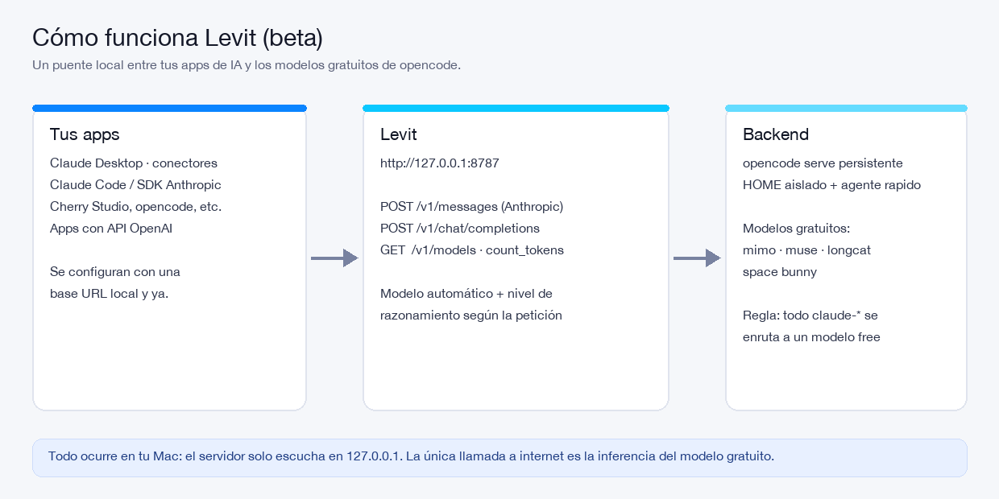
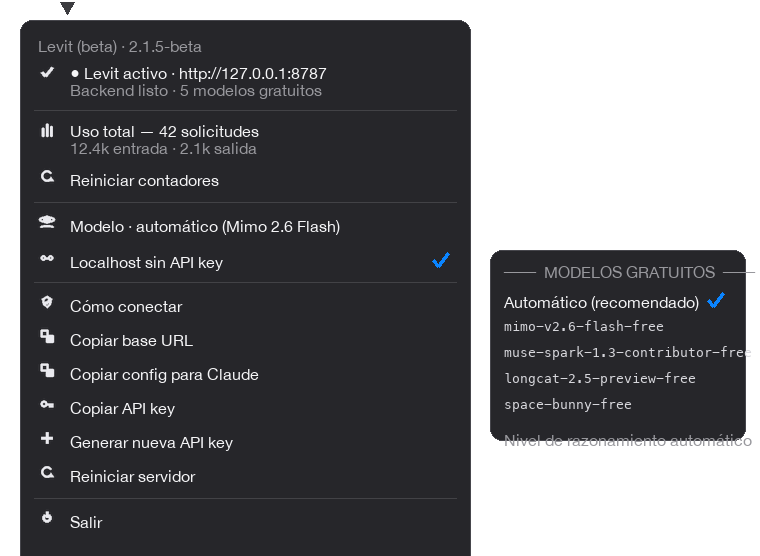
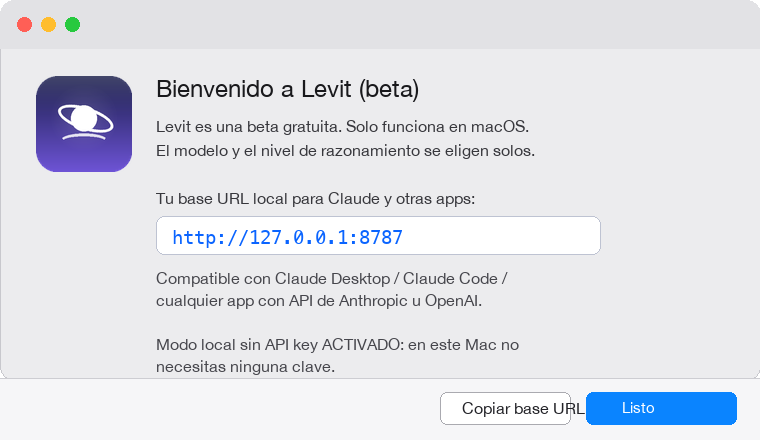

<p align="center">
  
</p>

<h1 align="center">Levit</h1>

<p align="center">
  <b>Puente local para Claude y otras apps de IA · modelos gratuitos incluidos</b><br>
  <i>Beta gratuita · solo macOS</i>
</p>

<p align="center">
  
  
  
  
</p>

> **Levit es una beta gratuita y de código cerrado (no open source).**
> Solo existe para **macOS**. Se puede **descargar e instalar** desde los
> [Releases](https://github.com/Justin20083/Levit-Releases/releases), pero el
> código no está publicado y **no está permitido modificarlo, renombrarlo ni
> revenderlo** (ver [TERMS.md](TERMS.md) y [LICENSE](LICENSE)).
>
> Es **gratis hasta nuevo aviso** y **siempre habrá un plan gratuito**.

---



## ¿Qué hace?

Levit corre en tu Mac y expone una **API local compatible con Anthropic
(y OpenAI)** en `http://127.0.0.1:8787`. Por dentro usa la CLI de
[opencode](https://opencode.ai) para enrutar cada petición a **modelos
gratuitos**, con un backend persistente optimizado (respuestas en ~4–8 s).

Así, **Claude Desktop, Claude Code o cualquier app** que permita configurar una
base URL personalizada pueden usarlo **sin API key de pago**.

- ✅ **Solo modelos gratuitos** (catálogo auto-actualizado cada 2 minutos)
- ✅ **Modelo automático por defecto** + selector de modelos free en el menú
- ✅ **Nivel de razonamiento adaptativo**: `minimal` → `xhigh` según lo que pidas
- ✅ **Imágenes**: si el modelo principal no las admite, otro modelo las describe
- ✅ **Sin API key en tu Mac** (modo localhost activado por defecto)
- ✅ **Compatible con conectores/gateway de Claude**: descubrimiento de
  modelos, inferencia, `count_tokens` y keepalives `ping`
- ✅ **También compatible con apps OpenAI** (`/v1/chat/completions`, streaming)
- ✅ **100 % local**: escucha solo en `127.0.0.1`, sin telemetría
- ✅ **Menú de barra monocromo** con estado, uso de tokens y acciones



## Instalación

> Este repositorio solo publica los **paquetes de descarga**: el código
> fuente de Levit no está disponible (software propietario).

1. Descarga **`Levit-2.1.5.pkg`** desde
   [Releases](https://github.com/Justin20083/Levit-Releases/releases).
2. Ábrelo (doble clic). Si macOS lo bloquea por no estar firmado:
   **Ctrl+clic → Abrir → Abrir**, o bien:
   ```bash
   xattr -dr com.apple.quarantine "Levit-2.1.5.pkg"
   ```
3. Introduce tu contraseña de administrador y espera.

**Qué instala el `.pkg`:**

| Componente | Destino |
|---|---|
| App Levit (menú de barra) | `/Applications/Levit.app` |
| Autoarranque con la sesión | `~/Library/LaunchAgents/app.levit.plist` |
| CLI de opencode | `~/.opencode/bin/opencode` |

El instalador **instala o actualiza la CLI de opencode automáticamente**
(`curl -fsSL https://opencode.ai/v2/install | bash`); si ya la tienes, se
salta la instalación e intenta actualizarla sin bloquear nada. También retira
versiones anteriores (Aqua Router / Nexo / Opencode Router).

Al terminar, la app se abre y muestra la **pantalla de bienvenida** con tu
base URL:



## Modelos: automático por defecto (con selector)

**Por defecto Levit decide solo** y puedes ver la decisión en el menú →
*Modelo* → *Automático (recomendado)*. Si prefieres, abre ese submenú y fija
uno concreto de la lista de modelos gratuitos (se marca con ✓).

- **Automático:** se prefiere el más rápido y fiable; si la conversación
  supera ~120 000 tokens salta automáticamente al modelo con más contexto (1 M).
- **Nivel de razonamiento:** cada petición se clasifica en
  `minimal` · `low` · `medium` · `high` · `xhigh`.
  Un "Hola" va a `low` (respuesta corta y rápida); un problema con
  "paso a paso", código, imágenes o una conversación larga sube a `high`/`xhigh`.
- **Visibilidad:** las respuestas traen las cabeceras `x-levit-reasoning` y
  `x-levit-model` y el log local imprime
  `[levit] <nivel> · <modelo> · N img · score=N`.

```bash
curl -s -D - -o /dev/null http://127.0.0.1:8787/v1/messages \
  -H 'content-type: application/json' -H 'anthropic-version: 2023-06-01' \
  -d '{"model":"claude-sonnet-4-6","max_tokens":50,
       "messages":[{"role":"user","content":"Hola"}]}' | grep x-levit
```

## Conectar con Claude Desktop

1. Abre Levit desde el icono de la barra de menú (esfera con órbita) y
   comprueba: **"● Levit activo · http://127.0.0.1:8787"**.
2. En Claude Desktop, abre **Configuración → Conectores / Credenciales de
   gateway** y añade uno nuevo:
   - **URL base del gateway:** `http://127.0.0.1:8787`
   - **Esquema de autenticación:** `x-api-key`
   - **Clave de API:** déjala vacía (el modo **Localhost sin API key** está
     activado por defecto) o pega la clave del menú **Copiar API key**.
3. Guarda. Claude hará su prueba de conexión: descubrimiento de modelos
   (`GET /v1/models`), `count_tokens` e inferencia — todo responde desde
   Levit.

> ¿Error de conexión ("gateway unreachable")? Revisa que la app muestre
> "● Levit activo" y prueba **Reiniciar servidor** en el menú.

## Conectar con Claude Code (CLI)

```bash
export ANTHROPIC_BASE_URL=http://127.0.0.1:8787
# opcional en local (modo sin API key activo):
# export ANTHROPIC_API_KEY=sk-router-...
claude
```

Cualquier petición a `claude-*` se enruta automáticamente a un modelo
gratuito (regla: `model.contains("claude") → modelo free por defecto`).

## Compatibilidad con conectores de apps (estilo Claude nativo) — beta 1.1

Levit imita el comportamiento que los conectores nativos de Claude esperan de
un gateway, para que la app conecte sin tocar nada más:

| Qué espera el conector | Soporte en Levit |
|---|---|
| Descubrimiento `GET /v1/models` (y `/{id}`) | ✅ 7 ids `claude-*` + modelos gratuitos |
| Sondeo `HEAD /v1/models` | ✅ |
| Inferencia `POST /v1/messages` (no-stream) | ✅ |
| Inferencia en streaming SSE | ✅ `message_start` → `ping` → `content_block_*` → `message_delta` → `message_stop` |
| Keepalive `event: ping` inmediato | ✅ |
| `POST /v1/messages/count_tokens` | ✅ |
| API key `x-api-key` / `Authorization: Bearer` | ✅ (o sin clave en local) |
| Headers `anthropic-beta`, `x-stainless-*`, `anthropic-dangerous-direct-browser-access` | ✅ reflejados en CORS |
| `request-id` en la respuesta | ✅ |
| Formato OpenAI `POST /v1/chat/completions` (stream + `stream_options.include_usage`) | ✅ |

**Estado: beta 1.1** — probado con Claude Desktop (conectores), Claude Code y
apps con API OpenAI. Si tu app falla al conectar, abre una issue con la app y
la respuesta de `/health`.

## Otras apps compatibles

Cualquier app que permita **base URL personalizada**:

| App | Qué configurar |
|---|---|
| Cherry Studio / LM Studio / Chatbox (modo API) | Base URL `http://127.0.0.1:8787` (formato Anthropic u OpenAI) |
| opencode, OpenCode SDK, apps OpenAI | `POST /v1/chat/completions` |
| SDKs de Anthropic | `ANTHROPIC_BASE_URL=http://127.0.0.1:8787` |

## API

### Anthropic

| Método | Ruta | Notas |
|---|---|---|
| `POST` | `/v1/messages` | Con `stream: true` soporta SSE completo (`message_start`, `ping`, deltas, `message_stop`) |
| `POST` | `/v1/messages/count_tokens` | Estimación rápida |
| `GET` | `/v1/models` | 7 ids `claude-*` + modelos gratuitos |
| `GET` | `/v1/models/{id}` | Detalle de modelo |

### OpenAI

| Método | Ruta | Notas |
|---|---|---|
| `POST` | `/v1/chat/completions` | Streaming SSE + `stream_options.include_usage` |

### Diagnóstico

| Método | Ruta | Notas |
|---|---|---|
| `GET` | `/health` | Estado del backend, `auth`, endpoints (`service: levit`) |
| `HEAD` | `/v1/models` | Sondeos de conectores |

```bash
curl http://127.0.0.1:8787/health
curl http://127.0.0.1:8787/v1/models | python3 -m json.tool
```

### Cabeceras de respuesta

| Cabecera | Contenido |
|---|---|
| `x-levit-reasoning` | `minimal` · `low` · `medium` · `high` · `xhigh` |
| `x-levit-model` | modelo free realmente usado |
| `Server` | `Levit/2.1.5-beta` |

## Modelos y reglas de enrutamiento

- **Solo modelos gratuitos** (`*-free`), sin planes de pago.
- El catálogo se refresca automáticamente **cada 2 minutos** con
  `opencode models` (los modelos de bajo rendimiento están en blacklist).
- **Regla de enrutamiento:** si el modelo pedido contiene `claude`
  (p. ej. `claude-haiku-4-5`), se envía al **modelo gratuito automático**.
- **Selector en el menú**: *Modelo → Automático (recomendado)* o cualquier
  modelo free de la lista. Fijar uno solo afecta a tu Mac.
- Cada respuesta actualiza los contadores de uso locales (menú → *Uso total*).

## Seguridad y privacidad

- Solo escucha en **`127.0.0.1`** (nunca expuesto a la red).
- Sin telemetría ni recolección de datos: ver [PRIVACY.md](PRIVACY.md).
- Tus API keys se guardan solo en tu Mac
  (`~/Library/Application Support/Levit/`).
- Lee los [Términos y Condiciones](TERMS.md) antes de usarlo.

## Solución de problemas

| Síntoma | Solución |
|---|---|
| "Puerto ocupado" | Cierra otra instancia o cambia el puerto en `config.json` |
| "opencode CLI no encontrado" | El pkg lo instala/actualiza; o ejecuta `curl -fsSL https://opencode.ai/v2/install \| bash` |
| Primera respuesta lenta (~30 s) | El backend está calentando; la siguiente tarda ~4–8 s |
| Los modelos cambiaron | Espera 2 min o reinicia el servidor desde el menú |
| Claude rechaza la conexión | Comprueba `/health`, que esté en `127.0.0.1` y sin proxy (`NO_PROXY=127.0.0.1`) |
| "No se puede abrir porque viene de un desarrollador no identificado" | **Ctrl+clic → Abrir**, o `xattr -dr com.apple.quarantine` |

## Hoja de ruta

- **Hoy:** beta 2.1.5, solo modelos gratuitos, puente local Anthropic + OpenAI,
  modelo automático y niveles de razonamiento.
- **Mañana:** producto completo. **Habrá siempre un plan gratuito**, con
  funciones premium opcionales de pago.

## Legal

- [Términos y Condiciones](TERMS.md)
- [Política de Privacidad](PRIVACY.md)
- [Licencia propietaria](LICENSE) — **no es open source**

> Claude y Anthropic son marcas de Anthropic PBC. opencode es marca de sus
> respectivos titulares. Levit **no está afiliado** con ellos; solo declara
> compatibilidad técnica con sus APIs.

---

<p align="center">Levit · beta 2.1.5 · descargas en <a href="https://github.com/Justin20083/Levit-Releases/releases">Levit-Releases</a></p>
